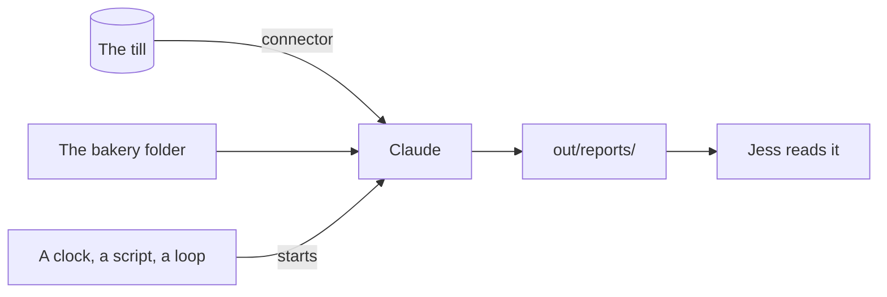

# Connect it and let it run

## After this part you can

Connect Claude to a real system, check its work with a helper, and run a job with nobody there.

## You leave with

A till connector and a Monday report skill. The skill has a read-only checker. You also get a script that runs it with `-p`, and a note with a cron line and a loop line.

## The problem

Jess wants the Monday report without asking for it. The numbers live in the till, not in a file Claude can guess at. For example, the whole till holds £13,609.80, but one day took far less. A job that runs by itself must be right before you stop watching it.

A solar firm uses Claude to sort permit emails. "About 71% of emails are fully processed without human intervention" ([Freedom Forever](https://claude.com/customers/freedom-forever)).



## Steps

| Step                                                                          | What you make                               | What the check reads                                     |
| ----------------------------------------------------------------------------- | ------------------------------------------- | -------------------------------------------------------- |
| [open-the-terminal](01-open-the-terminal/problem/README.md)                   | `out/terminal.md`                           | The version is new enough; the mode is named             |
| [connect-the-till](02-connect-the-till/problem/README.md)                     | The till connector and `out/till-today.md`  | The connector is there; the total matches the till       |
| [make-the-monday-skill](03-make-the-monday-skill/problem/README.md)           | A `monday-report` skill and a report        | Sales, Waste, Late payers; every number matches the till |
| [write-the-monday-report](04-write-the-monday-report/problem/README.md)       | A read-only checker and a worktree note     | The checker cannot write; the note names the worktree    |
| [keep-every-report](05-keep-every-report/problem/README.md)                   | Two reports, each with its own file         | A Made at line; reports at least a minute apart          |
| [schedule-the-monday-report](06-schedule-the-monday-report/problem/README.md) | A cron note, `run-report.sh`, `out/loop.md` | A cron line of numbers; a script with `-p`; a loop line  |

The free plan and some work laptops cannot run scheduled tasks. The last step has a second way to pass for them.

## Walkthrough

Open a terminal, go to the course folder, then into the bakery. To check, ask Claude: "Please check my work for the step name. Run it and tell me what it printed. Do not change anything to make it pass." The commands below are what Claude runs. The [ways of working](../../00-orientation/ways-of-working.md) page lists every mode and command used here.

First, start Claude Code in the bakery folder and find Plan mode.

```bash
bun run verify open-the-terminal
```

Expect: `Done. All 7 rules pass.`

Next, add the till and ask for the last day's takings.

```bash
bun run verify connect-the-till
```

Expect: `Done. All 7 rules pass.`

Then make the skill, add a checker, and try a second run in a worktree.

```bash
bun run verify make-the-monday-skill
bun run verify write-the-monday-report
```

Expect: `Done. All 10 rules pass.` and then `Done. All 13 rules pass.`

Last, keep each run, then run alone with a script and a loop.

```bash
bun run verify keep-every-report
bun run verify schedule-the-monday-report
```

Expect: `Done. All 8 rules pass.` and then `Done. All 12 rules pass.`

To check the whole part at once:

```bash
bun run verify part connect-and-schedule
```

Expect: `Part connect-and-schedule is done: 6/6 steps pass.`

## Watch and read

| Kind  | Title                                                      | Author           | Why                                                       | Link                                                                  |
| ----- | ---------------------------------------------------------- | ---------------- | --------------------------------------------------------- | --------------------------------------------------------------------- |
| video | Claude Code advanced patterns: Subagents, MCP, and scaling | Anthropic        | The makers show subagents and connectors at work.         | <https://claude.com/resources/webinars/claude-code-advanced-patterns> |
| video | Claude Code: Advanced                                      | Anthropic        | A hands-on session on worktrees, loops and parallel work. | <https://claude.com/resources/webinars/claude-code-workshop-advanced> |
| read  | Run Claude Code programmatically                           | Claude Code docs | How `claude -p` runs with no chat, and what to allow.     | <https://code.claude.com/docs/en/headless>                            |
| read  | Run prompts on a schedule                                  | Claude Code docs | Loops and scheduled tasks, and when each one stops.       | <https://code.claude.com/docs/en/scheduled-tasks>                     |
| read  | Common workflows                                           | Claude Code docs | Parallel sessions with worktrees, step by step.           | <https://code.claude.com/docs/en/common-workflows>                    |
| read  | Connect Claude Code to tools through MCP                   | Claude Code docs | How a connector is added and checked.                     | <https://code.claude.com/docs/en/mcp>                                 |

## Project

Pick one report you make by hand each week. Give it a skill with a Never part, a read-only checker, and a script that runs it with `-p`. Read the first run before you trust it. Hand in the skill, the script and two reports.
