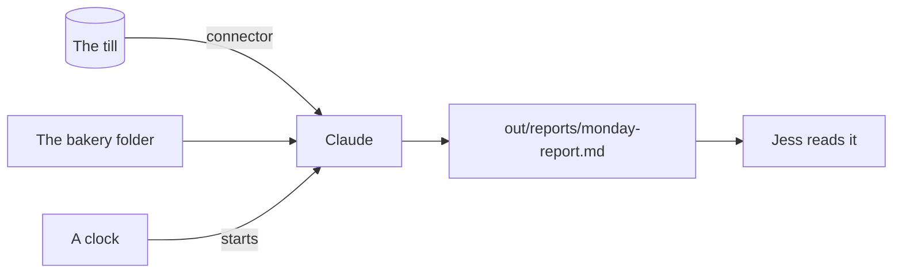

# Connect it and let it run

This part moves you toward the goal of the course: a Friday close that runs on its own, from the real record, and that you can trust.

## The problem

Jess wants the Monday report without asking for it. The numbers live in the till, not in a file Claude can guess at. And a job that runs by itself must be right before you stop watching it.

A solar firm uses Claude to sort permit emails. "About 71% of emails are fully processed without human intervention" ([Freedom Forever](https://claude.com/customers/freedom-forever)).

In this part, you meet the terminal and connect the till to Claude. Then Claude turns the report into a skill, and you set it to run on its own.

For example, the report has a "## Late payers" part. It names Kettle and Crumb and Moss and Grain, from Jess's notes.



## The steps

| Step                                                                          | Minutes | What you make                              | What the check reads                                           |
| ----------------------------------------------------------------------------- | ------- | ------------------------------------------ | -------------------------------------------------------------- |
| [open-the-terminal](01-open-the-terminal/problem/README.md)                   | 15      | `out/terminal.md`                          | The version is new enough; the mode is named                   |
| [connect-the-till](02-connect-the-till/problem/README.md)                     | 20      | The till connector and `out/till-today.md` | The connector is there; the total matches the till             |
| [write-the-monday-report](03-write-the-monday-report/problem/README.md)       | 25      | A `monday-report` skill and the report     | Sales, Waste, Late payers; every number matches the till       |
| [schedule-the-monday-report](04-schedule-the-monday-report/problem/README.md) | 15      | Two reports from the skill                 | Made by a scheduled task, or by Run now plus `out/schedule.md` |

The free plan and some work laptops cannot run scheduled tasks. The last step has a second way to pass for them.

## Walkthrough

This part starts in the terminal. Open a terminal, go to the course folder, then into the bakery. Run each check from there.

First, start Claude Code in the bakery folder. Write down its version and the Plan mode words, as the step page shows.

```bash
bun run verify open-the-terminal
```

Expect: `Done. All 7 rules pass.`

Next, add the till as a connector, approve it in Claude Code, and ask for the last day's takings.

```bash
bun run verify connect-the-till
```

Expect: `Done. All 7 rules pass.`

Then ask Claude to make the `monday-report` skill, and run it with `/monday-report`.

```bash
bun run verify write-the-monday-report
```

Expect: `Done. All 10 rules pass.`

Last, make each run keep its own report. Run it two times, with a scheduled task or with Run now.

```bash
bun run verify schedule-the-monday-report
```

Expect: `Done. All 9 rules pass.`

To check the whole part at once:

```bash
bun run verify part connect-and-schedule
```

Expect: `Part connect-and-schedule is done: 4/4 steps pass.`

## Finished

You now have Claude Code in the terminal, a till connector that can only read, and a `monday-report` skill. The skill writes a new report each run, with numbers from the till. You read the first runs before you let it run alone.

In the next part, you share it. You put the skill in a kit that a new person can install. Then you run the whole Friday close on new orders and bills.

## Read more

- [Desktop scheduled tasks](https://code.claude.com/docs/en/desktop-scheduled-tasks.md): how the app runs a task, and why a run is skipped when the computer sleeps.
- [Connect Claude Code to tools through MCP](https://code.claude.com/docs/en/mcp.md): `claude mcp add`, and how to see if a connector is connected.
