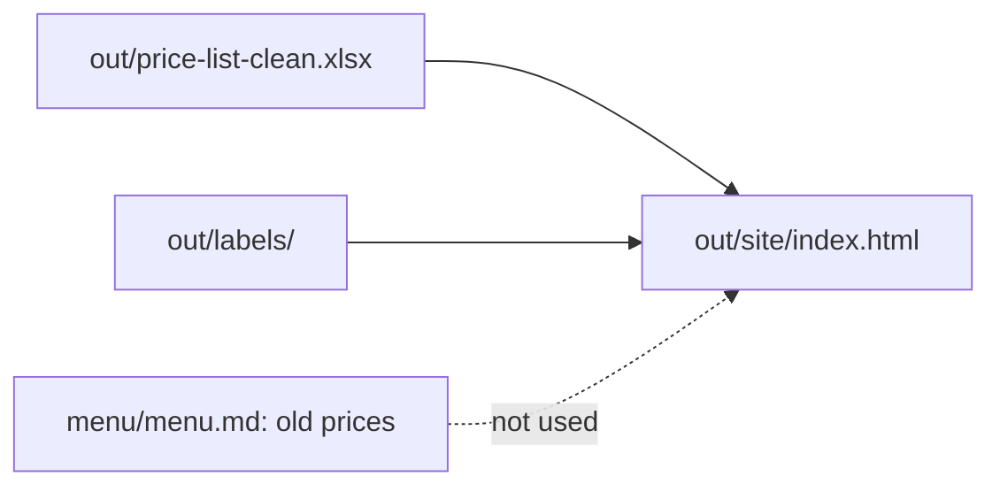
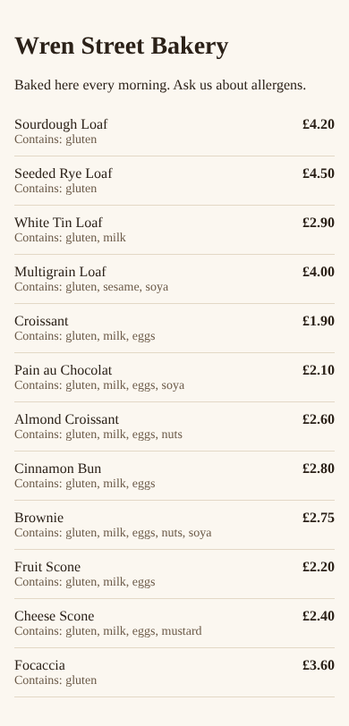

# Publish the menu page

## The problem

The wall menu shows the Multigrain Loaf at £4.00, and its old label says gluten and soya. The clean files say sesame is on top too. A customer with a sesame allergy could get ill. Jess wants one page with the right price and allergens, and it must work with no internet.



## Watch it done

For example, the old label for the Multigrain Loaf says:

```text
Contains: gluten, soya
```

After, the page made from the clean files says this for the same loaf:

```text
Multigrain Loaf   £4.00   Contains: gluten, sesame, soya
```



## Your turn

Do the smallest page first: one product.

1. Start Claude Code inside the bakery folder.

```bash
cd wren-street && claude
```

Expect: Claude Code opens and waits for you.

2. Paste this:

```text
Make out/site/index.html with only the Multigrain Loaf. Take its price
from out/price-list-clean.xlsx and its allergens from
out/labels/multigrain-loaf.md. Put all the style inside the page.
```

Expect: a plan that names `out/price-list-clean.xlsx` and `out/labels/`, not `menu/menu.md`. Say yes.

3. Open `out/site/index.html` in your browser. Make the window narrow, like a phone.

Expect: "Multigrain Loaf", a price, and "Contains: gluten, sesame, soya".

## Do it on your work

Now the whole menu. Paste this in the same session:

```text
Make out/site/index.html: one menu page for Wren Street Bakery.
Show every product on out/price-list-clean.xlsx with its shop price.
Under each product, show "Contains:" and its allergens from its label
in out/labels/. Put all the style inside the page. Load nothing from
another site. Make it easy to read on a phone.
```

Read the plan before you say yes. Good looks like 12 products, the Sourdough Loaf at £4.20 (the old menu said £4.00), and no link that starts with `http`. A person still checks every allergen, because this course teaches a way of working, not food law.

## Done when

- `out/site/index.html` shows all 12 products.
- Each product shows its clean price and every allergen in its recipe.
- The page loads no script, style or font from another site.
- No original file has changed.

To check, ask Claude: "Please check my work for publish-the-menu-page. Run the command and tell me what it printed. Do not change anything to make it pass." It runs:

```bash
bun run verify publish-the-menu-page
```

Expect: `Done. All 7 rules pass.`

## Solution

The finished page is `solution/out/site/index.html`. The prompt and what to say no to are in `solution/prompts.md`.

## If you get stuck

| What you see                               | Try this                                                           |
| ------------------------------------------ | ------------------------------------------------------------------ |
| `FAIL  each product shows its price`       | Ask Claude to use `out/price-list-clean.xlsx`, not the old menu.   |
| `FAIL  each product shows every allergen`  | Ask Claude to use `out/labels/`, not the old `labels/`.            |
| `FAIL  it loads nothing from another site` | Ask Claude to take out any font or script link that starts `http`. |

## Go further

- Add a line at the bottom that says when the prices were last checked, in words, not a date format.

## Words you will use

- **Web page**: a file a browser opens. Its name ends in `.html`.
- **Offline**: with no internet.
- **Allergen**: a food that can make some people ill, like sesame or nuts.
