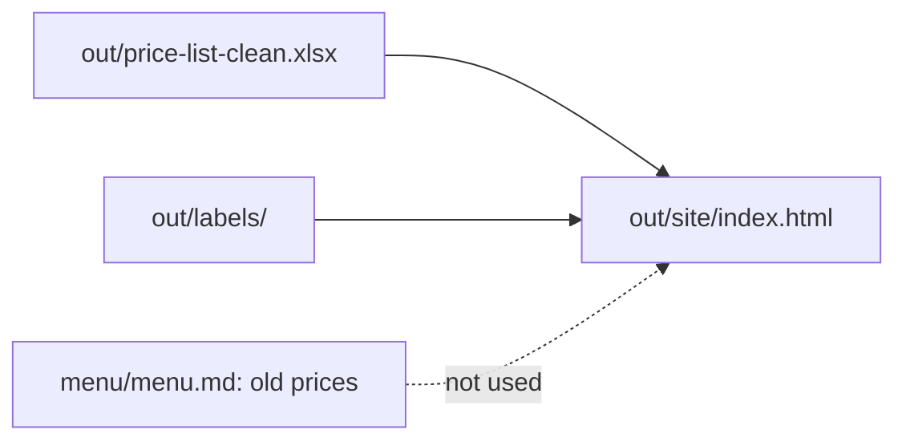

# Publish the menu page

## The problem

The menu on the shop wall has old prices. Some old labels miss an allergen. A customer who reads the wrong one pays the wrong price, or eats something that makes them ill.

Jess wants one page that a customer can open on a phone. It must use the clean prices and the new labels. And it must work with no internet, so it loads nothing from another site.

This course teaches a way of working, not food law. A person still checks every allergen before the page goes up.



## Your challenge

Ask Claude to build the menu page from your own clean files.

1. Start `claude` in `wren-street`. Paste this:

```text
Make out/site/index.html: one menu page for Wren Street Bakery.
Show every product on out/price-list-clean.xlsx with its shop price.
Under each product, show "Contains:" and its allergens from its label
in out/labels/. Put all the style inside the page. Load nothing from
another site. Make it easy to read on a phone.
```

2. Before you say yes, read the plan. Check that it reads the clean price list, not `menu/menu.md`.
3. Open the page in your browser. Make the window narrow, like a phone.

For example, the Multigrain Loaf now has sesame on top. Its old label says "gluten, soya". The page must say "Contains: gluten, sesame, soya".

## Done when

- `out/site/index.html` shows all 12 products.
- Each product shows its clean price and every allergen in its recipe.
- The page loads no script, style or font from another site.
- No original file has changed.

```bash
bun run verify publish-the-menu-page
```

Expect: `Done. All 7 rules pass.`


## If you get stuck

| What you see                               | Try this                                                           |
| ------------------------------------------ | ------------------------------------------------------------------ |
| `FAIL  each product shows its price`       | Ask Claude to use `out/price-list-clean.xlsx`, not the old menu.   |
| `FAIL  each product shows every allergen`  | Ask Claude to use `out/labels/`, not the old `labels/`.            |
| `FAIL  it loads nothing from another site` | Ask Claude to take out any font or script link that starts `http`. |
| `FAIL  it shows all 12 products`           | Ask Claude to count the rows of the price list and the page.       |

## Words you will use

- **Web page**: a file a browser opens. Its name ends in `.html`.
- **Offline**: with no internet.
- **Allergen**: a food that can make some people ill, like sesame or nuts.
