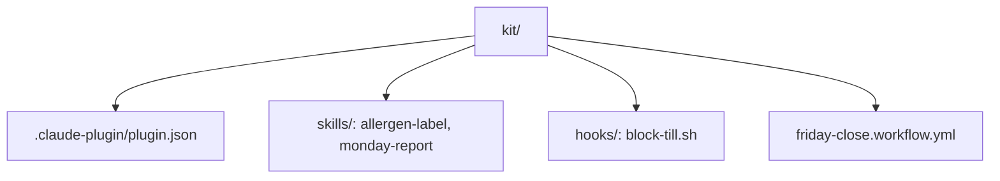

# Pack the bakery kit

## The problem

Your skills live on your laptop. A new person at the bakery has none, so their labels come out different. A plugin is a kit you can hand on: one folder with your skills in it. Anthropic's legal team built theirs "in an afternoon, not by coding anything" ([Anthropic](https://claude.com/resources/guides/deploying-claude-across-your-organization/how-anthropic-teams-use-cowork)).



## Watch it done

Before, a new person types `/wren` and sees nothing. After, the kit is checked and installed:

```text
√ Validation passed
```

Then `/wren` lists both skills, and the hook stops an edit to the till:

```text
wren-street-kit:allergen-label
wren-street-kit:monday-report
Blocked: till/ is the record. Do not edit it.
```

## Your turn

A **hook** is a small script that Claude Code runs by itself, every time, before a tool runs. Make one that guards `till/sales.csv`.

1. In Claude Code, inside `wren-street`, paste this:

```text
Make kit/hooks/hooks.json with a PreToolUse hook, matcher "Write|Edit",
that runs ${CLAUDE_PLUGIN_ROOT}/hooks/block-till.sh. Make that script read
the tool call from its input. If the file path has till/ in it, print a
short reason and exit with code 2. Otherwise exit 0.
```

Expect: a plan with two files in `kit/hooks/`. Say yes, then type `/exit`.

2. Try the script by hand on the till file:

```bash
echo '{"tool_input":{"file_path":"till/sales.csv"}}' | bash kit/hooks/block-till.sh; echo $?
```

Expect: a short reason, then `2`.

3. Try it on a file that is allowed:

```bash
echo '{"tool_input":{"file_path":"out/notes.md"}}' | bash kit/hooks/block-till.sh; echo $?
```

Expect: `0`.

## Do it on your work

Now pack the whole kit, and add a **GitHub Action**: a file that tells GitHub to run a job for you. Its timer line is a **cron** line, five fields for minute, hour, day, month and weekday. Paste this:

```text
In kit/, make .claude-plugin/plugin.json with "name": "wren-street-kit",
"version": "1.0.0", a one line "description" and "license": "CC0-1.0".
Copy .claude/skills/allergen-label and .claude/skills/monday-report into
kit/skills/, next to .claude-plugin/. Then save kit/friday-close.workflow.yml,
not under .github/. It runs on a schedule and on workflow_dispatch, and one
step runs claude -p to do the Friday close. Take the key from a secrets
placeholder. Never write a real key.
```

Good looks like this timer line in the file, and a key written as a placeholder, never a real one:

```yaml
- cron: "0 7 * * 5"
ANTHROPIC_API_KEY: ${{ secrets.ANTHROPIC_API_KEY }}
```

Then let Claude Code check the kit:

```bash
claude plugin validate kit
```

Expect: `√ Validation passed`. Warnings about an icon can stay.

## Done when

- The manifest has a name with dashes, a version like 1.0.0 and a description.
- `kit/skills/` holds both skills, and none sit inside `.claude-plugin/`.
- The hook stops an edit to `till/` and lets other edits through.
- The workflow file has a schedule or workflow_dispatch, a step that runs claude, and a secrets placeholder.
- No original file has changed.

To check, ask Claude: "Please check my work for pack-the-bakery-kit. Run the command and tell me what it printed. Do not change anything to make it pass." It runs:

```bash
bun run verify pack-the-bakery-kit
```

Expect: `Done. All 14 rules pass.`

## Solution

The finished kit is in `solution/kit/`, including `friday-close.workflow.yml`. The prompt is in `solution/prompts.md`.

## If you get stuck

| What you see                                | Try this                                                       |
| ------------------------------------------- | -------------------------------------------------------------- |
| `FAIL  it has a name in kebab-case`         | Use small words and dashes, like `wren-street-kit`.            |
| `FAIL  the skills sit next to .claude-plugin/` | Move the skills up one level, into `kit/skills/`.           |
| `FAIL  the workflow has a step that runs claude` | Ask Claude to add a `run:` line with `claude -p`.         |
| The `/wren` menu is empty                   | Start with `claude --plugin-dir kit` from `wren-street`.       |

## Go further

- Install the kit from a second folder with `claude --plugin-dir`.
- Copy the workflow to `.github/workflows/` in a test repository and run it by hand.

## Words you will use

- **Plugin**: a folder of skills and settings that someone else can install.
- **Manifest**: the file `plugin.json`, with the name and version.
- **Secret**: a key GitHub keeps for you, so it is never written in a file.
