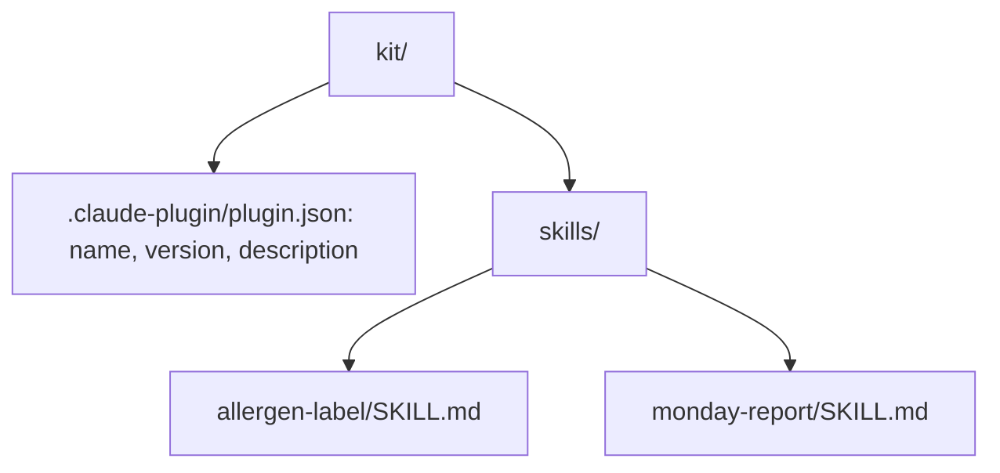

# Pack the bakery kit

## The problem

Your skills live in `.claude/skills/` on your laptop. A new person at the bakery has none of them. They would start from a blank page and make different labels.

A plugin is a kit you can hand on. It holds your skills in one folder. Someone else installs it, and gets the same skills. Anthropic's legal team built theirs "in an afternoon, not by coding anything" ([Anthropic](https://claude.com/resources/guides/deploying-claude-across-your-organization/how-anthropic-teams-use-cowork)).



## Your challenge

Ask Claude to pack both skills into a plugin in `kit/`. Then try it.

1. Start `claude` in `wren-street`. Paste this:

```text
Make a Claude Code plugin in kit/. Put the manifest at
kit/.claude-plugin/plugin.json with "name": "wren-street-kit",
"version": "1.0.0", a one line "description", and "license": "CC0-1.0".
Copy .claude/skills/allergen-label and .claude/skills/monday-report
into kit/skills/. The skills sit next to .claude-plugin/, not inside it.
```

2. Read the plan. Check where the skills go. Then say yes. Type `/exit`.
3. Ask Claude Code to check the kit:

```bash
claude plugin validate kit
```

Expect: `√ Validation passed`. It may also print warnings about an icon or a license for a public listing. You can leave those.

4. Try it the way a new person would:

```bash
claude --plugin-dir kit
```

Expect: Claude Code starts. Type `/wren` and the menu shows `/wren-street-kit:allergen-label` and `/wren-street-kit:monday-report`.

For example, a new person types `/wren-street-kit:allergen-label` for the Brownie. They get the same label shape as you, with nuts and soya on it.

## Done when

- `kit/.claude-plugin/plugin.json` has a name with dashes, a version like 1.0.0 and a description.
- `kit/skills/` holds `allergen-label` and `monday-report`, each with its name and description.
- No skill is inside `.claude-plugin/`.
- No original file has changed.

To check, ask Claude:

```text
Please check my work for pack-the-bakery-kit. Run bun run verify pack-the-bakery-kit and tell me what it printed. Do not change anything to make it pass.
```

It runs:

```bash
bun run verify pack-the-bakery-kit
```

Expect: `Done. All 8 rules pass.`

## If you get stuck

| What you see                                   | Try this                                                             |
| ---------------------------------------------- | -------------------------------------------------------------------- |
| `FAIL  it has a name in kebab-case`            | Use small words and dashes, like `wren-street-kit`. No spaces.       |
| `FAIL  it has a version like 1.0.0`            | Ask Claude to add `"version": "1.0.0"`.                              |
| `FAIL  the skills sit next to .claude-plugin/` | Ask Claude to move the skills up one level, into `kit/skills/`.      |
| The `/wren` menu is empty                      | Start Claude Code with `claude --plugin-dir kit` from `wren-street`. |

## Words you will use

- **Plugin**: a folder of skills and settings that someone else can install.
- **Manifest**: the file `plugin.json`. It gives the plugin its name and version.
- **Kebab-case**: small words joined by dashes, like `wren-street-kit`.
