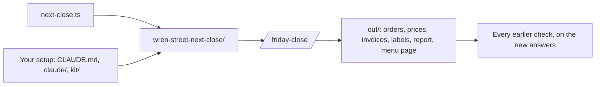

# Run the Friday close

## The problem

So far, each job ran on the bakery's first set of files. You knew every answer. A real close comes with new orders, new bills and new sales each time. A setup that only works on the files you tested is not done.

So the test now is the real one. You run the whole close once, on files you have never seen. Then every earlier check runs again on what Claude made.



## Your challenge

Make the close one skill. Then run it once on a new folder.

1. Start `claude` in `wren-street`. Paste this:

```text
Make a skill at .claude/skills/friday-close/SKILL.md, named
friday-close. Its description says: use it to run the Friday close.
Steps, in order, each writing only to out/: say what is in the
folder, clean the orders, fix the price list, check the invoices,
make the labels with allergen-label, write the report with
monday-report, and make the menu page. Add "## Never": never change
an original file, and never sign a label.
```

2. Read the skill. Each step should name the file it writes, like `out/orders-clean.csv`. Say yes. Type `/exit`.
3. In the course folder, make the new folder. It gets new files and a copy of your setup:

```bash
bun parts/06-share-the-close/next-close.ts
```

Expect: `Made the next close: wren-street-next-close/`

4. Go into it and start Claude Code. Type `/friday-close`, then read each step before you say yes.

```bash
cd wren-street-next-close
```

Expect: no output. Then type `claude`.

For example, the new orders have a different count of rows. A skill that wrote the old count into the file fails here. A skill that counts each time passes.

## Done when

- `wren-street-next-close/` is there, with the `friday-close` skill.
- Every earlier check of the close passes again on the new files: the folder note, orders, prices, invoices, labels, report and menu page.

```bash
bun run verify run-the-friday-close
```

Expect: `Done. All 7 rules pass.`


## If you get stuck

| What you see                               | Try this                                                                          |
| ------------------------------------------ | --------------------------------------------------------------------------------- |
| `FAIL  the next close folder ... is there` | Run `bun parts/06-share-the-close/next-close.ts` in the course folder.            |
| `FAIL  the close is one skill`             | Make the skill in `wren-street`. Then run `next-close.ts reset`.                  |
| `FAIL  clean-the-orders passes again`      | Read that step's page. Ask Claude to fix the step in the skill, and run it again. |
| You want to start the next close again     | Run `bun parts/06-share-the-close/next-close.ts reset`.                           |

## Words you will use

- **The close**: all the jobs of the Friday close, done in order, from orders to the menu page.
- **New files**: orders, bills and sales the check made for this test, that you have never seen.
- **Setup**: your `CLAUDE.md`, settings, hooks and skills.
