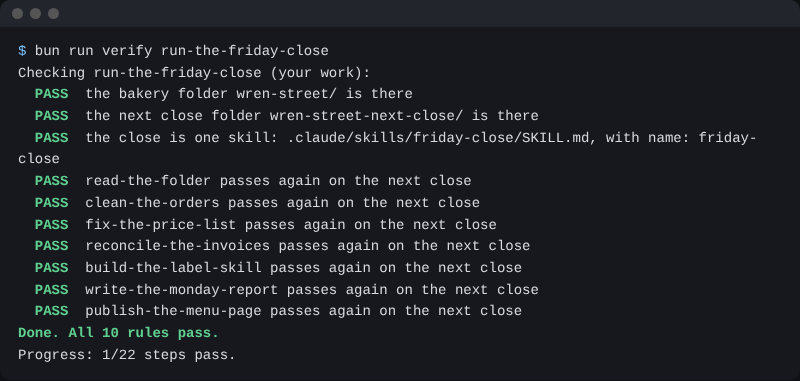

# Run the Friday close

## The problem

So far each job ran on files you knew. A real close brings new orders and bills each week, and the answers change. Anthropic's legal team "pointed Claude at 742 Jira tickets" in one go ([Anthropic](https://claude.com/resources/guides/deploying-claude-across-your-organization/how-anthropic-teams-use-cowork)). A setup that only works on the files you tested is not done.

## Watch it done

For example, the new orders have a different count of rows. A skill that wrote the old count into the file fails. A skill that counts each time passes. The real check output on the new folder:

```text
  PASS  clean-the-orders passes again on the next close
  PASS  publish-the-menu-page passes again on the next close
Done. All 13 rules pass.
```



## Your turn

Make the close one skill, then run it once on a folder with new files.

1. In `wren-street`, start Claude Code and paste this:

```text
Make .claude/skills/friday-close/SKILL.md, named friday-close, to run
the Friday close. Steps in order, each writing only to out/: say what
is in the folder, clean the orders, fix the price list, check the
invoices, make the labels, write the report, make the menu page.
Add "## Never": never change an original file, never sign a label.
```

Expect: a skill where each step names a file, like `out/orders-clean.csv`. Say yes, then `/exit`.

2. From the course folder, make the new folder:

```bash
bun parts/06-share-the-close/next-close.ts
```

Expect: `Made the next close: wren-street-next-close/`

3. Go in, start Claude Code, and type `/friday-close`. Read each step before you say yes.

```bash
cd wren-street-next-close && claude
```

Expect: Claude Code opens. The new orders file has a different row count from the old one.

## Do it on your work

Go back to `wren-street` and ask for three files in `out/`:

```text
Save out/batch.md with one line that starts with /batch: add the line
"Made fresh each day" under the name in every file in out/labels/, and
change nothing else. Write out/run-contract.md with the headings "## Task",
"## Stop when", "## May touch" and "## Must not touch", one or two
lines each. Write out/metrics.md with dash lines, each with a number:
files made, checks passed, invoices flagged. Count them from the run.
```

A `/batch` line makes Claude fan one change over many files at once. A **run contract** says what the job is, when it stops, and what it may touch. **Metrics** are numbers about a run. Good looks like numbers you can find in `out/`, not guesses.

## Done when

- `wren-street-next-close/` has the `friday-close` skill.
- Every earlier check passes again on the new files.
- `out/batch.md` has a `/batch` line, `out/run-contract.md` has its parts, and `out/metrics.md` has 3 numbers.

To check, ask Claude: "Please check my work for run-the-friday-close. Run the command and tell me what it printed. Do not change anything to make it pass." It runs:

```bash
bun run verify run-the-friday-close
```

Expect: `Done. All 13 rules pass.`

## Solution

The finished skill is `solution/.claude/skills/friday-close/SKILL.md`. The three files are in `solution/out/`.

## If you get stuck

| What you see                           | Try this                                                    |
| -------------------------------------- | ----------------------------------------------------------- |
| `FAIL  clean-the-orders passes again`  | Ask Claude to fix that step in the skill, and run it again. |
| `FAIL  out/batch.md has a /batch line` | Start the line with `/batch` and name a folder in `out/`.   |
| You want to start the next close again | Run `bun parts/06-share-the-close/next-close.ts reset`.     |

## Words you will use

- **The close**: all the Friday jobs, in order.
