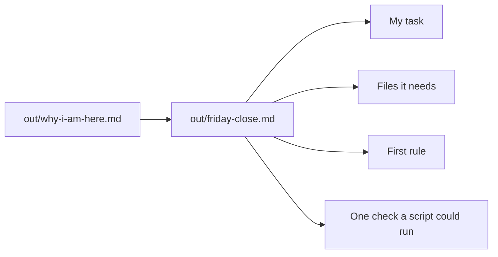

# Map your own close

## The problem

The bakery was practice. At the start you wrote one task from your own job in `out/why-i-am-here.md`. Now you need a plan for your own desk. A close that carries to any job has four parts: the task, its files, one rule Claude must never break, and a check a script can run.



## Watch it done

For example, a person who matches delivery notes to orders first wrote a check no script can run:

```text
## One check a script could run

Claude checks it.
```

After, it is a yes or no test on a file:

```text
## One check a script could run

Every delivery note number is in out/matches.csv once.
```

## Your turn

Practise on the bakery first, with the one hard part: the check.

1. Start Claude Code in `wren-street`.

```bash
claude
```

Expect: Claude Code opens.

2. Paste this:

```text
Look at orders/wholesale-orders.csv. Write one yes or no test a script
could run on out/orders-clean.csv. Do not write "Claude checks it".
```

Expect: a line like "Every order_id is in the file once". If a script cannot answer yes or no, it is not a check.

## Do it on your work

Now your own task. Use made-up names, not real data from your job. Paste this:

```text
Read out/why-i-am-here.md. Make out/friday-close.md with four headings.
"## My task": my sentence, in my words.
"## Files it needs": each file the task reads, one per line with a dash.
"## First rule for its CLAUDE.md": the one rule Claude must never break.
"## One check a script could run": one yes or no test on a file.
Ask me questions first. Do not guess about my job.
```

Answer Claude's questions, then read the map. Good looks like 2 or more of your own files, not the bakery's, and a check with a yes or no answer.

## Done when

- `out/friday-close.md` has the task from `out/why-i-am-here.md`.
- It lists 2 or more of your own files.
- It has a first rule and one check a script could run.

To check, ask Claude: "Please check my work for map-your-own-close. Run the command and tell me what it printed. Do not change anything to make it pass." It runs:

```bash
bun run verify map-your-own-close
```

Expect: `Done. All 7 rules pass.`

## Solution

A finished map for a person who matches delivery notes to orders is `solution/out/friday-close.md`. The prompt is in `solution/prompts.md`.

## If you get stuck

| What you see                              | Try this                                                       |
| ----------------------------------------- | -------------------------------------------------------------- |
| `FAIL  "## My task" is the task`          | Copy the words of your sentence from `out/why-i-am-here.md`.   |
| `FAIL  "## Files it needs" lists 2`       | Name the files your task uses at work, not the bakery's files. |
| `FAIL  "## One check a script could run"` | Write a test with a yes or no answer, about a file.            |

## Words you will use

- **Map**: a short plan that says how the bakery way fits your own job.
- **Check**: a test a script runs on a file, with a yes or no answer.
