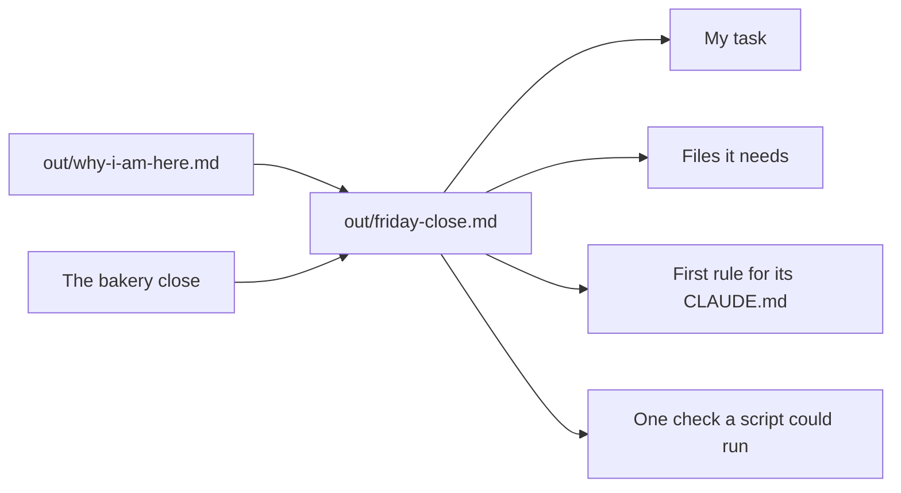

# Map your own close

## The problem

The bakery was practice. At the very start, you wrote one task from your own job in `out/why-i-am-here.md`. Now you know the way of working. You need a plan to use it at your own desk, with your own files.

The bakery close has four parts that carry over to any job: the task, the files it reads, the rule Claude must never break, and a check a script can run.



## Your challenge

Ask Claude to turn your sentence into a map, in the bakery's shape. Use made-up names, not real data from your job.

1. Start `claude` in `wren-street`. Paste this:

```text
Read out/why-i-am-here.md. Make out/friday-close.md with four headings.
"## My task": my sentence, in my words.
"## Files it needs": each file the task reads, one per line with a dash.
"## First rule for its CLAUDE.md": the one rule Claude must never break.
"## One check a script could run": one yes or no test on a file.
Ask me questions first. Do not guess about my job.
```

2. Answer Claude's questions about your job. Then read the map before you say yes.

For example, a person who matches delivery notes to orders writes this check: "Every delivery note number is in out/matches.csv once." A script can test that. "Claude checks it" is not a check.

## Done when

- `out/friday-close.md` has the task from `out/why-i-am-here.md`.
- It lists 2 or more of your own files, not the bakery's.
- It has a first rule and one check a script could run.
- No original file has changed.

```bash
bun run verify map-your-own-close
```

Expect: `Done. All 7 rules pass.`

## If you get stuck

| What you see                              | Try this                                                       |
| ----------------------------------------- | -------------------------------------------------------------- |
| `FAIL  "## My task" is the task`          | Copy the words of your sentence from `out/why-i-am-here.md`.   |
| `FAIL  "## Files it needs" lists 2`       | Name the files your task uses at work, not the bakery's files. |
| `FAIL  "## One check a script could run"` | Write a test with a yes or no answer, about a file.            |

## Words you will use

- **Map**: a short plan that says how the bakery way fits your own job.
- **Rule**: a line in `CLAUDE.md` that Claude reads each time it starts.
- **Check**: a test a script runs on a file, with a yes or no answer.
