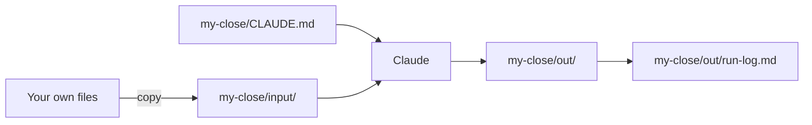

# Run your own close

## The problem

The bakery was practice. Your real job has its own files, and the way of working only counts once it runs on them. But you must not risk the originals.

So you work on a copy. If Claude gets it wrong, the real files are safe.



## Your challenge

Use the task from `out/friday-close.md`. Use made-up or cleaned files, with no real names or secrets.

1. Make the folder `my-close/` inside `wren-street`. Copy 2 or more of your own files into `my-close/input/`.
2. Start `claude` in `my-close`. Paste this:

```text
Read the files in input/. Write CLAUDE.md here with a "## Never" heading
and a rule that stops you changing anything in input/. Then do my task
from ../out/friday-close.md. Save every result in out/.
```

3. Read each result before you say yes. Then ask Claude to write the run log:

```text
Write out/run-log.md with four headings: "## What I asked", "## Files I used",
"## What Claude made" and "## How I checked". List files with a dash.
```

4. Tell Claude, in your own words, which result you opened and what you found. Ask it to put that under "How I checked".

For example, a person who matches delivery notes to orders opens `matches.csv`, finds the note for order O-1, and sees 12 loaves on both.

## Done when

- `my-close/input/` holds 2 or more of your own files.
- `my-close/CLAUDE.md` has a Never rule.
- `my-close/out/` holds a result and the run log.
- Every file the log names is really there.
- Your last part says what you looked at and what you found.

To check, ask Claude:

```text
Please check my work for run-your-own-close. Run bun run verify run-your-own-close and tell me what it printed. Do not change anything to make it pass.
```

It runs:

```bash
bun run verify run-your-own-close
```

Expect: `Done. All 8 rules pass.`

## If you get stuck

| What you see                                 | Try this                                           |
| -------------------------------------------- | -------------------------------------------------- |
| `FAIL my-close/input/ holds a copy`          | Copy your own files, not the bakery's.             |
| `FAIL every file under Files I used is in`   | List only names that are in `my-close/input/`.     |
| `FAIL How I checked says what you looked at` | Write a few lines about what you opened and found. |

## Words you will use

- **Copy**: a duplicate you can change. The original stays safe.
- **Run log**: a short note of what you asked, what Claude made and how you checked.
- **Evidence**: a file or a line that shows the work was done.
