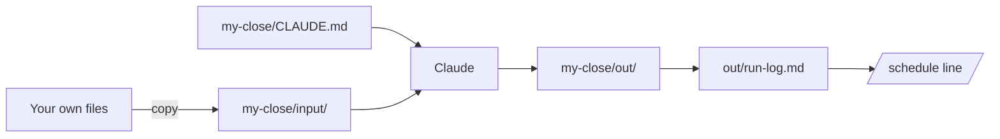

# Run your own close

## The problem

The bakery was practice. Your real job has its own files, and the way of working only counts once it runs on them. You work on a copy, so the originals stay safe. Then you let it run by itself, on a timer.



## Watch it done

For example, a person who matches delivery notes to orders ends the log like this. The last heading holds the timer line:

```text
## How I checked

I opened matches.csv and compared N-7 with order O-1.
Both say 12 loaves, and the file says yes.

## When it runs by itself

- /schedule every Monday at 7, run the match task on a copy of this folder.
```

## Your turn

Try the rules on an empty folder first.

1. From the course folder, copy the template:

```bash
cp -r capstone/template wren-street/my-close
```

Expect: no output.

2. Run the capstone check on it:

```bash
bun capstone/check.ts wren-street/my-close
```

Expect: lines that start with FAIL, and one about a `/schedule` task.

## Do it on your work

Use the task from `out/friday-close.md`, with made-up or cleaned files.

1. Copy 2 or more of your own files into `my-close/input/`.
2. Start `claude` in `my-close` and paste this:

```text
Read the files in input/. Write CLAUDE.md here with a "## Never" heading
and a rule that stops you changing anything in input/. Then do my task
from ../out/friday-close.md. Save every result in out/.
```

3. Read each result before you say yes. Then ask for the log:

```text
Write out/run-log.md with five headings: "## What I asked", "## Files I used",
"## What Claude made", "## How I checked" and "## When it runs by itself".
List files with a dash. Under the last heading, write one line that
starts with /schedule and says when it runs, like: /schedule every Monday at 7
```

4. Tell Claude which result you opened and what you found, and ask it to put that under "How I checked".

Good looks like a log that names only real files, and a timer line. The same rules run on your folder with `bun capstone/check.ts my-close`.

## Done when

- `my-close/input/` holds 2 or more of your own files.
- `my-close/CLAUDE.md` has a Never rule.
- `my-close/out/` holds a result and the run log.
- Every file the log names is really there.
- The log says what you looked at, and names a `/schedule` task.

To check, ask Claude: "Please check my work for run-your-own-close. Run the command and tell me what it printed. Do not change anything to make it pass." It runs:

```bash
bun run verify run-your-own-close
```

Expect: `Done. All 10 rules pass.`

## Solution

A finished folder, made of practice files, is `solution/my-close/`. The prompts are in `solution/prompts.md`.

## If you get stuck

| What you see                                 | Try this                                           |
| -------------------------------------------- | -------------------------------------------------- |
| `FAIL every file under Files I used is in`   | List only names that are in `my-close/input/`.     |
| `FAIL When it runs by itself names a`        | Add a line with `/schedule` and when it runs.      |

## Words you will use

- **Copy**: a duplicate you can change. The original stays safe.
- **Run log**: a short note of what you asked, made and checked.
- **Schedule**: a timer that runs the task for you, such as every Monday at 7.
