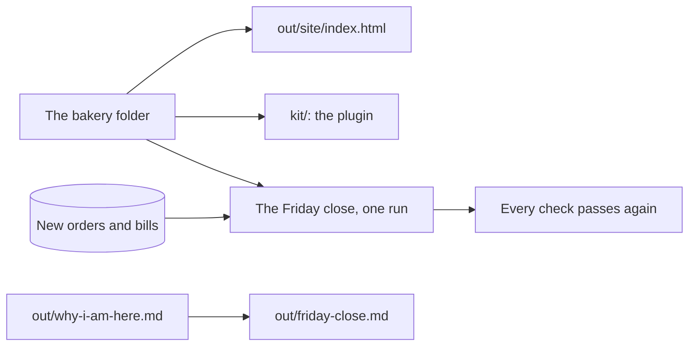

# Share it

This part proves the goal of the course: your Friday close runs on new files you have never seen, and every check still passes.

## The problem

Everything you built lives on one laptop. A new person at the bakery could not run it. And the Friday close is still many small jobs, not one.

Anthropic's legal team packed their way of working into a plugin. Then they "pointed Claude at 742 Jira tickets, the full legal intake backlog" ([Anthropic](https://claude.com/resources/guides/deploying-claude-across-your-organization/how-anthropic-teams-use-cowork)).

In this part, you publish the menu page and pack your skills as a kit. Then you run the whole close on new orders and bills that you have never seen. Last, you map the close onto your own job.

For example, the menu page `out/site/index.html` shows each product with its price and allergens. The Croissant shows £1.90 and "Contains: gluten, milk, eggs".



## The steps

| Step                                                                | Minutes | What you make                                    | What the check reads                                                   |
| ------------------------------------------------------------------- | ------- | ------------------------------------------------ | ---------------------------------------------------------------------- |
| [publish-the-menu-page](01-publish-the-menu-page/problem/README.md) | 25      | `out/site/index.html`                            | Every product, the right price and allergens, works offline            |
| [pack-the-bakery-kit](02-pack-the-bakery-kit/problem/README.md)     | 20      | `kit/.claude-plugin/plugin.json` and both skills | The kit parses and holds both skills                                   |
| [run-the-friday-close](03-run-the-friday-close/problem/README.md)   | 25      | One skill that runs the whole close              | Every earlier check passes on new files the check makes                |
| [map-your-own-close](04-map-your-own-close/problem/README.md)       | 15      | `out/friday-close.md`                            | Your own task, its files, its first rule, one check a script could run |

## Walkthrough

Open a terminal in the course folder. Start Claude Code in `wren-street` for each job, as each step page shows. Run each check from the course folder.

To check, ask Claude to check your work. Say: "Please check my work for the step name. Run it and tell me what it printed. Do not change anything to make it pass." The commands below are what Claude runs. The [ways of working](../../00-orientation/ways-of-working.md) page lists every mode and command used here.

First, ask Claude for the menu page, from the clean prices and the new labels.

```bash
bun run verify publish-the-menu-page
```

Expect: `Done. All 7 rules pass.`

Next, ask Claude to pack both skills into `kit/`. Claude Code checks the kit itself:

```bash
claude plugin validate wren-street/kit
```

Expect: `√ Validation passed`

```bash
bun run verify pack-the-bakery-kit
```

Expect: `Done. All 11 rules pass.`

Then make the `friday-close` skill, make the new folder, and run `/friday-close` in it once.

```bash
bun parts/06-share-the-close/next-close.ts
```

Expect: `Made the next close: wren-street-next-close/`

```bash
bun run verify run-the-friday-close
```

Expect: `Done. All 10 rules pass.`

Last, ask Claude to map the close onto your own task.

```bash
bun run verify map-your-own-close
```

Expect: `Done. All 7 rules pass.`

To check the whole part at once:

```bash
bun run verify part share-the-close
```

Expect: `Part share-the-close is done: 4/4 steps pass.`

## Assignment

The problem: the setup lives on one laptop, and the close takes a whole morning.

Hand in these files from your `wren-street` folder: `out/site/index.html`, `kit/`, and `out/friday-close.md`. Also hand in `wren-street-next-close/out/`, which your close made.

Each question is yes or no:

1. Does `bun run verify run-the-friday-close` pass on the new files?
2. Does `claude plugin validate wren-street/kit` say `√ Validation passed`?
3. Does a fresh `claude --plugin-dir kit` list both skills?
4. Does the menu page show sesame on the Multigrain Loaf?
5. Does `out/friday-close.md` name one check a script could run on your own task?

To go further, build a second folder for another job, with its own planted mistakes. For example, a letting agent's rent list, with one rent paid twice. Then run the same steps on it.

## Finished

You now have a Friday close that runs as one skill, on files it has never seen, and checks that prove it. You have a kit a new person can install, and a menu page a customer can open. You also have a map of how this way of working fits your own job.

This is the end of the course. Your next step is your own map: make a practice folder for your task, and start with its `CLAUDE.md` rule.

## Read more

- [Plugins](https://code.claude.com/docs/en/plugins.md): what a plugin holds and how someone else installs it.
- [Plugins reference](https://code.claude.com/docs/en/plugins-reference.md): where each file goes, and `claude plugin validate`.
