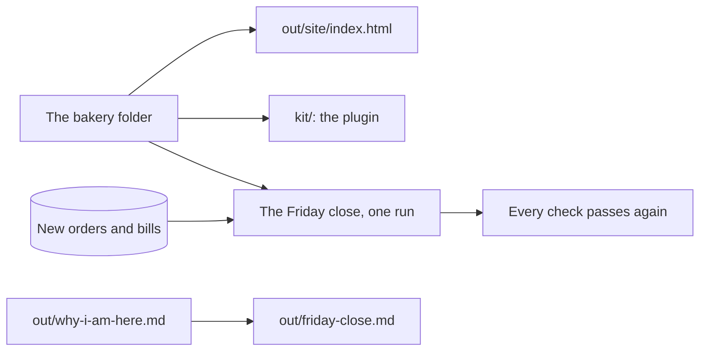

# Share it

## The problem

Everything you built lives on one laptop. A new person at the bakery could not run it. And the Friday close is still many small jobs, not one.

Anthropic's legal team packed their way of working into a plugin. Then they "pointed Claude at 742 Jira tickets, the full legal intake backlog" ([Anthropic](https://claude.com/resources/guides/deploying-claude-across-your-organization/how-anthropic-teams-use-cowork)).

In this part, you publish the menu page and pack your skills as a kit. Then you run the whole close on new orders and bills that you have never seen. Last, you map the close onto your own job.

For example, the menu page `out/site/index.html` shows each product with its price and allergens. The Croissant shows £1.90 and "Contains: gluten, milk, eggs".



## The steps

| Step                  | Minutes | What you make                                    | What the check reads                                                   |
| --------------------- | ------- | ------------------------------------------------ | ---------------------------------------------------------------------- |
| publish-the-menu-page | 25      | `out/site/index.html`                            | Every product, the right price and allergens, works offline            |
| pack-the-bakery-kit   | 20      | `kit/.claude-plugin/plugin.json` and both skills | The kit parses and holds both skills                                   |
| run-the-friday-close  | 25      | One skill that runs the whole close              | Every earlier check passes on new data the check drops in              |
| map-your-own-close    | 15      | `out/friday-close.md`                            | Your own task, its files, its first rule, one check a script could run |

## Walkthrough

TODO(part session): one paragraph per step and its exact Expect line.

```bash
bun run verify part share-the-close
```

Expect: TODO(part session)
