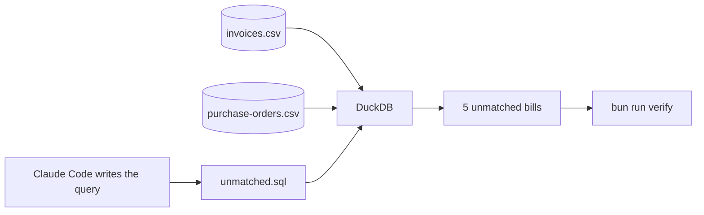

# Find the unmatched invoices

## The problem

Jess has 24 bills and 23 orders. Reading each bill took a long time. Next month there will be 200. For example, bill `FD-2204` charges £6.45 a kg for butter, but the order says £6.20.

**DuckDB** is a free tool that answers questions about CSV files, which are tables saved as plain text.



## Watch it done

The saved query asks which bills do not match their order. DuckDB printed:

```text
┌─────────┬─────────┬────────────────┐
│ invoice │   po    │     reason     │
├─────────┼─────────┼────────────────┤
│ FD-2204 │ PO-3013 │ price above PO │
│ FD-2205 │ PO-3017 │ price above PO │
│ FD-2206 │ PO-3021 │ price above PO │
│ FD-2207 │ PO-3005 │ duplicate      │
│ HL-873  │ PO-3014 │ short delivery │
└─────────┴─────────┴────────────────┘
```

Before, you had a long read. After, one saved file gives these rows again on new files.

## Your turn

The files are `invoices.csv` (one row for each bill) and `purchase-orders.csv` (what Jess ordered). Claude Code writes the SQL.

1. Open the folder `assignment/starter` in Claude Code. Stay in Manual mode.
2. Paste this:

   ```text
   There are two CSV files here: invoices.csv and purchase-orders.csv. Use DuckDB 2.0.0
   to list the invoices that have no matching purchase order line. Save the query as
   unmatched.sql in this folder.
   ```

   Expect: Claude may ask to install DuckDB. Say yes. The file `unmatched.sql` appears.
3. Ask: "Say in plain words what matched means before you trust the query."

   Expect: "the first bill for an order, at the agreed price and quantity".
4. Ask Claude to run the query and show the rows.

   Expect: 5 rows. `FD-2202` is not one, because only the second bill on an order is the copy.
5. Write each prompt you used in `prompts.md`. Then ask Claude: "Please check my work for find-the-unmatched-invoices. Run the verify command and tell me what it printed. Do not change anything to make it pass." It runs:

   ```bash
   bun run verify find-the-unmatched-invoices
   ```

Expect: `Done. All 2 rules pass.`

## Do it on your work

Pick two CSV files of your own that share one column. Open Claude Code in their folder and ask which rows in the first file have no good match in the second. Ask what matched means first.

Good looks like this: you can say the rule in one sentence and you checked one row by hand.

## Done when

- The saved query `unmatched.sql` runs with DuckDB.
- It lists the same bills as the answer key, no more and no fewer.

The check runs your query and compares the rows. It cannot tell who wrote the query.

## Solution

The finished query and prompts are in `solution/`.

## Go further

- Ask for the extra money Jess would have paid.

## If you get stuck

| What you see                                      | Try this                                                               |
| ------------------------------------------------- | ---------------------------------------------------------------------- |
| `FAIL  The saved query runs with DuckDB 2.0.0`    | Ask Claude to save and run `unmatched.sql`. |
| `FAIL  The mismatch count matches the answer key` | Say what matched means. Only the second bill on an order is a copy.    |

## Words you will use

- **Query**: one question about your files, written in SQL.
- **Matched**: the first bill for an order, at the agreed price, for the quantity ordered.
