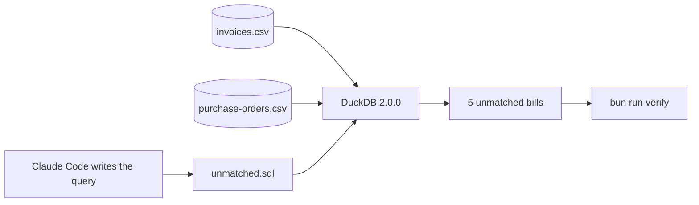

# Find the unmatched invoices

## The problem

You found the faulty bills by reading each one. That took a long time. A team that does this every month asks a question of the files instead.

**DuckDB** is a free tool that answers questions about CSV files. It needs no server. A **query** is one question, written in a language called SQL. You do not write SQL here. Claude Code writes it.

Two CSV files sit in `assignment/starter/`. `invoices.csv` has one row for each of the 24 bills. `purchase-orders.csv` has what Jess ordered.



For example, `FD-2204` bills butter at £6.45 a kg. The order says £6.20. DuckDB lists `FD-2204` because the two prices differ.

## Your challenge

Open the folder `assignment/starter` in Claude Code. Stay in Manual mode. Paste this:

```text
There are two CSV files here: invoices.csv and purchase-orders.csv. Use DuckDB 2.0.0
to list the invoices that have no matching purchase order line. Save the query as
unmatched.sql in this folder.
```

Claude may ask to install DuckDB. Say yes, because it is a normal package. Then ask Claude what "matched" means in plain words. Does it say first bill, agreed price and quantity ordered?

Write each prompt you used in `prompts.md`. Then run the check:

```bash
bun run verify find-the-unmatched-invoices
```

Expect: `Done. All 2 rules pass.`

## Done when

- The saved query `unmatched.sql` runs with DuckDB 2.0.0.
- The mismatch count matches the answer key.

## If you get stuck

| What you see                                      | Try this                                                               |
| ------------------------------------------------- | ---------------------------------------------------------------------- |
| `FAIL  The saved query runs with DuckDB 2.0.0`    | Ask Claude to save `unmatched.sql` in `assignment/starter` and run it. |
| `FAIL  The mismatch count matches the answer key` | Say what matched means. Only the second bill on an order is a copy.    |

## Options

A spreadsheet lookup is another way to match two lists.

- **Choose when** the files are small, and you only need to look once.
- **Trade-off:** it is slow and easy to get wrong past a few hundred rows. A query runs again on new files in one step.

## Words you will use

- **DuckDB**: a free tool that answers questions about files.
- **Query**: one question, saved in a file.
- **Matched**: the first bill for an order, at the agreed price, for the quantity ordered.
- **CSV**: a table saved as plain text.
