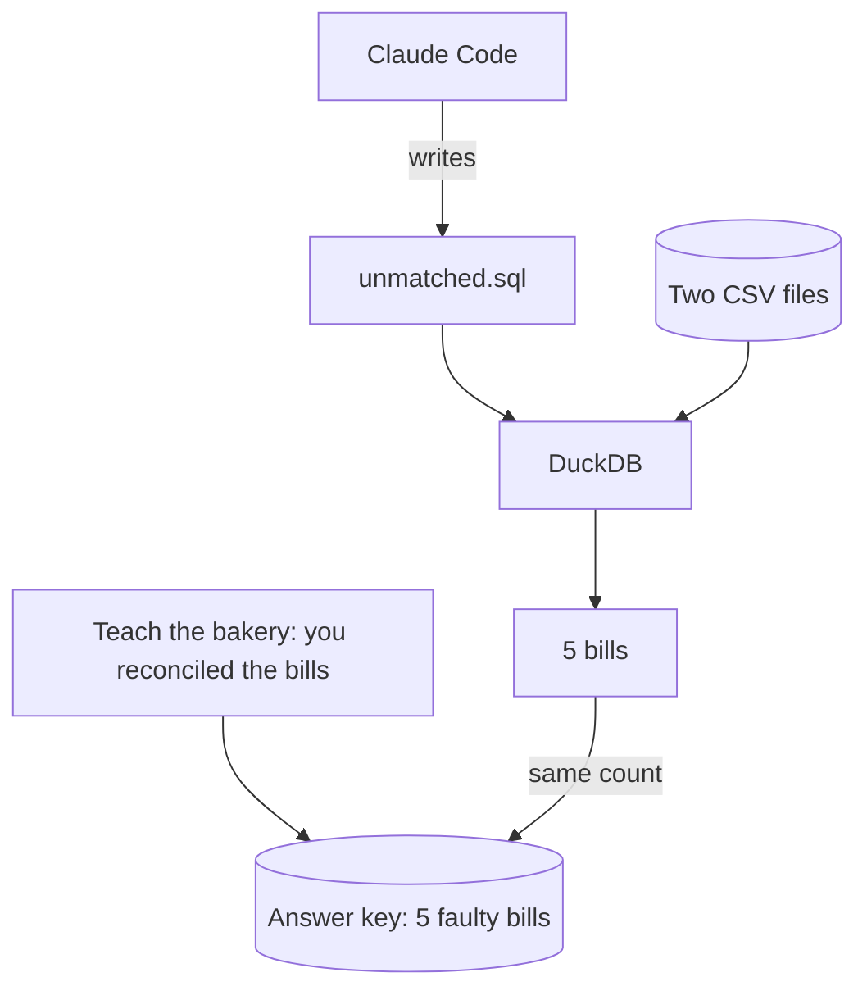

# Ask questions of your files with DuckDB

## After this part you can

Ask a question of two CSV files with one saved query, and get the same answer you found by hand.

## You leave with

A file `unmatched.sql` that lists the faulty bills, and a `prompts.md` that shows how you got it.

## The problem

You read and checked 24 bills against 23 orders. It worked, but next month there are 200 bills and a person cannot read them all. DuckDB is a free tool that reads CSV files with a query and needs no server. One query lists the same 5 faulty bills you found before. For example, it lists `FD-2204`, which charges £6.45 a kg where the order says £6.20. This part is optional in the live session and expected as homework.



## Steps

| Step                                                                            | What you make   | What the check reads                                  |
| ------------------------------------------------------------------------------- | --------------- | ----------------------------------------------------- |
| [find-the-unmatched-invoices](01-find-the-unmatched-invoices/problem/README.md) | `unmatched.sql` | The query runs and lists the 5 faulty bills it should |

## Walkthrough

Open `assignment/starter` in Claude Code. Ask for the query, as the step page says. Then run the check.

To check, ask Claude to check your work. Say: "Please check my work for the step name. Run it and tell me what it printed. Do not change anything to make it pass." The commands below are what Claude runs. The [ways of working](../../00-orientation/ways-of-working.md) page lists every mode and command used here.

```bash
bun run verify find-the-unmatched-invoices
```

Expect: `Done. All 2 rules pass.`

The same check runs as the take-home assignment. It writes `assignment/result.json`.

```bash
bun run assignment
```

Expect: `2 of 2 lines pass. Wrote assignment/result.json`

## Watch and read

| Kind | Title | Author | Why | Link |
| ---- | ----- | ------ | --- | ---- |

## Project

Pick two CSV files from your own work that share one column. Use made-up or cleaned data. Ask Claude to save a query that lists the rows in the first file with no good match in the second. Ask what matched means, check one row by hand, and keep the prompts in a note.

## Hand it in

Push a branch named `assignment` and send its URL. The grader runs `bun run assignment` again. A person then reads `prompts.md`. See [the assignment](../../assignment/README.md).

## FINISHED

You asked a question of your files and got the same answer you found before. Next time the files are bigger, you run the same query again.
