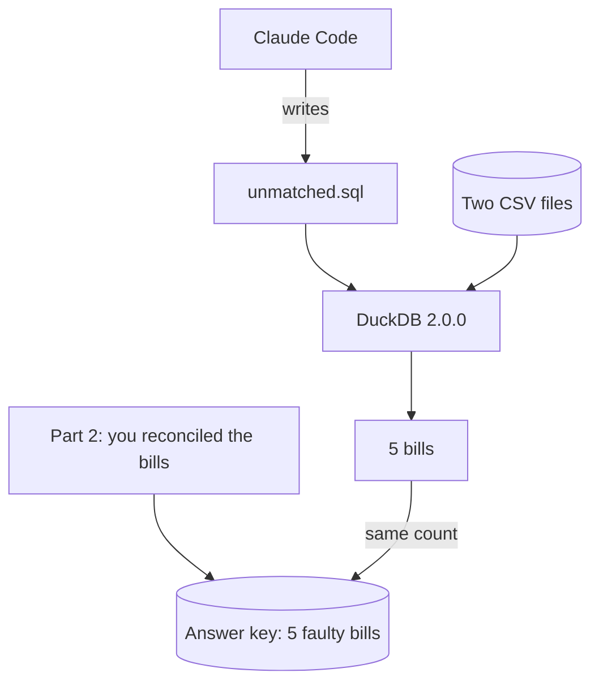

# Ask questions of your files with DuckDB

This part moves you toward the course goal: you redo one job with a tool teams use at work.

## The problem

Before, you read and checked 24 bills against 23 orders. It worked. But next month there are 200 bills, and a person cannot read them all.

Many teams ask questions of their files with DuckDB. It reads CSV files with a query and needs no server. This part is short. It is optional in the live session and expected as homework.

For example, one query lists every bill that is not the first bill for its order, or has the wrong price or quantity. It gives the same 5 bills you found before.



## The steps

| Step                                                                            | Minutes | What you make   | What the check reads                                          |
| ------------------------------------------------------------------------------- | ------- | --------------- | ------------------------------------------------------------- |
| [find-the-unmatched-invoices](01-find-the-unmatched-invoices/problem/README.md) | 20      | `unmatched.sql` | The query runs with DuckDB 2.0.0 and lists the 5 faulty bills |

## Walkthrough

Open `assignment/starter` in Claude Code. Ask for the query, as the step page says. Then run the check.

```bash
bun run verify find-the-unmatched-invoices
```

Expect: `Done. All 2 rules pass.`

The same check runs as the take-home assignment. It writes `assignment/result.json`.

```bash
bun run assignment
```

Expect: `2 of 2 lines pass. Wrote assignment/result.json`

## Hand it in

Push a branch named `assignment` and send its URL. The grader runs `bun run assignment` again. A person then reads `prompts.md`. See [the assignment](../../assignment/README.md).

## FINISHED

You asked a question of your files and got the same answer you found before. Next time the files are bigger, you run the same query again.
